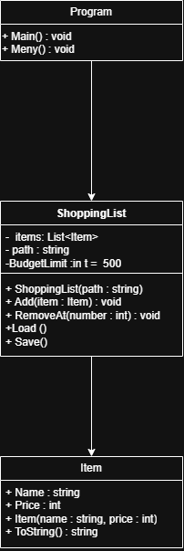

# Felrapport

## Fel 1

###### Problem:
När jag körde dotnet run kraschade programmet direkt.
Felmeddelandet visade at ShoppingList.Load() in C:\Users\Administrator\OneDrive\Documents\kk2-startkod-main\ShoppingList.cs:line 90
at Program.<Main>$(String[] args) in C:\Users\Administrator\OneDrive\Documents\kk2-startkod-main\Program.cs:line 2
Programmet kunde också krascha om filen items.txt saknades.

###### Orsak:
En rad i items.txt saknade namn eller pris.
Programmet gör Split(';') och förväntar sig två delar.
När raden inte har två delar finns inte parts[1], och då kraschar programmet.

###### Lösning:
Jag la till enkla kontroller i Load() så felaktiga rader hoppas över.
Jag kontrollerar: om raden är tom, om raden saknar semikolon, om priset inte går att läsa som ett tal.
Jag la också till en kontroll som ser om items.txt finns innan programmet försöker läsa filen. Om filen saknas avslutas Load() utan att programmet kraschar.

## Fel 2

###### Problem:
När jag skrev text istället för ett nummer i menyn kraschade programmet.
Felmeddelandet visade - System.FormatException: The input string was not in a correct format.

###### Orsak:
Programmet använder int.Parse() för att läsa menyvalet.
Om användaren skriver text går det inte att göra om till ett tal, och då kraschar programmet.

###### Lösning:
Jag bytte till int.TryParse() så programmet först kontrollerar om inmatningen är ett tal.
Om det inte är ett tal visas ett felmeddelande istället för att programmet kraschar.

## Fel 3

######  Problem:
När jag skrev text istället för ett nummer i priset kraschade programmet.
Felmeddelandet visade - System.FormatException: The input string was not in a correct format.

###### Orsak:
Programmet använder int.Parse() för att läsa priset.
Om användaren skriver text går det inte att göra om till ett tal, och då kraschar programmet.

###### Lösning:
Jag bytte till int.TryParse() så programmet först kontrollerar om priset är ett tal.
Om det inte är ett tal visas ett felmeddelande istället för att programmet kraschar.

## Fel 4

###### Problem:
När jag skrev text istället för ett nummer vid “Ta bort vara” kraschade programmet.
Felmeddelandet visade - System.FormatException: The input string was not in a correct format.
Programmet kraschade också när jag försökte ta bort ett nummer som inte fanns i listan, till exempel 1 när listan var tom eller 5 när listan bara hade en vara.

###### Orsak:
Programmet använder int.Parse() för att läsa numret som ska tas bort.
Om användaren skriver text går det inte att göra om till ett tal, och då kraschar programmet.
Programmet kontrollerade inte om numret fanns i listan innan det försökte ta bort varan. Då kastades ArgumentOutOfRangeException.

###### Lösning:
Jag ändrade till int.TryParse() och kollade att numret finns i listan innan jag tar bort varan. Jag rättade också så att number - 1 bara används en gång, eftersom listan börjar på 0 men numreringen för användaren börjar på 1.

### Fel 5

##### Problem:
När jag lade till en vara visades den korrekt i listan, men totalsumman blev ändå 0 kr, även om varan hade ett pris.
Exempel: Glass – 50 kr. Totalt: 0 kr.
Programmet räknade alltså inte ihop priserna och visade alltid 0 kr på Total.

##### Orsak:
I Total() började loopen på i = 1, vilket gjorde att den första varan inte räknades med.
Om listan bara hade en vara blev totalsumman därför 0 kr.

##### Lösning:
Jag ändrade loopen så att den börjar på i = 0 i stället för 1.
Då räknas alla varor med i totalsumman.

### Fel 6

##### Problem:
Programmet skrev alltid ut att listan var sparad, även om sparningen misslyckades.

##### Orsak:
I Save() fanns en tom catch som inte visade felmeddelande. Programmet skrev ändå ut att listan var sparad.

##### Lösning:
Jag ändrade så att användaren får ett felmeddelande om sparningen misslyckas. Meddelandet om att listan är sparad visas bara när sparningen lyckas. Jag kontrollerade också att Save() och Load() använder samma format: pris;namn.

## Designval – budgettak
Jag valde att kontrollera budgeten i ShoppingList.Add() i stället för i Program.cs. Då kontrolleras budgeten varje gång en vara läggs till. Om totalsumman skulle bli mer än 500 kr kastas ett InvalidOperationException. I Program.cs fångas felet och användaren får ett meddelande. Programmet kan sedan fortsätta som vanligt.

## UML-diagram
